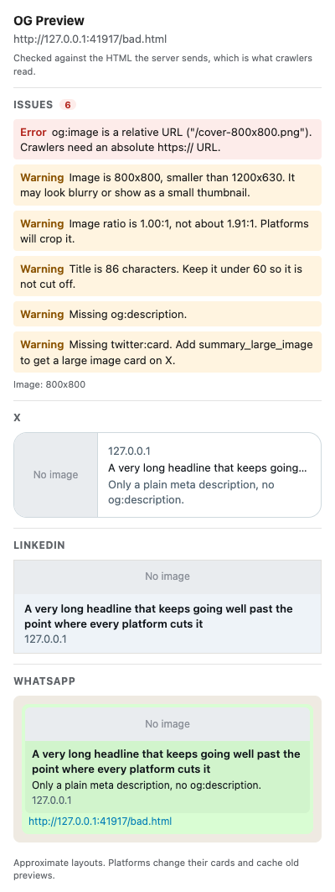
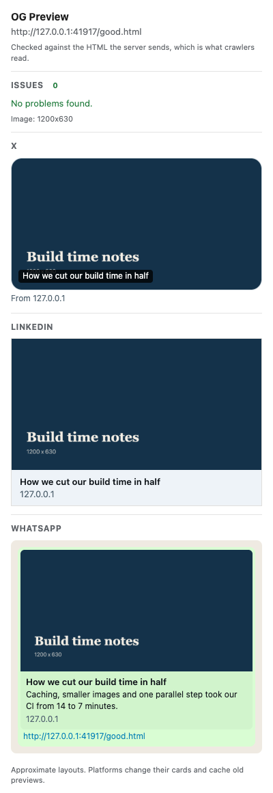
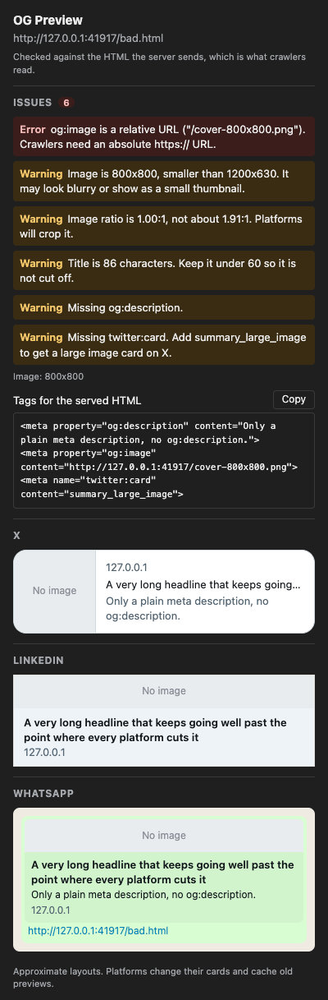

# OG Preview

A Chrome extension (Manifest V3) that shows how the page in the current tab will look when its link is shared on X, LinkedIn and WhatsApp, and lists the Open Graph and Twitter Card tags that need fixing.



## Why

Link previews are usually checked after the post is live, when a wrong image or a cut-off title is already in everyone's feed. The official debuggers need a public URL and one tab per platform. This popup reads the tags straight from the open tab, so it also works on staging and localhost.

## What it checks

| Check | Level |
|---|---|
| `og:image` missing | Error |
| `og:image`, `og:image:url` or `twitter:image` is a relative URL | Error |
| Image fails to load or takes longer than 10 s | Error |
| Image smaller than 1200x630 | Warning |
| Image ratio not about 1.91:1 (tolerance 0.1) | Warning |
| `og:title` missing (falls back to `<title>`; error if both are missing) | Warning |
| Title longer than 60 characters | Warning |
| `og:description` missing, or longer than 160 characters | Warning |
| `twitter:card` missing or not a valid card type | Warning |

The previews follow each platform's fallbacks: X reads `twitter:*` first and then `og:*`; LinkedIn and WhatsApp read `og:*`, then `<title>` and `meta name="description"`. A relative image URL is shown as "No image", because crawlers cannot resolve it either.

## Quick start

```bash
npm install
npm run build
```

Open `chrome://extensions`, turn on Developer mode, click "Load unpacked" and pick the `dist` folder. Open any web page and click the extension icon.

`npm run dev` starts Vite with hot reload; load `dist` the same way.

## Permissions

Only `activeTab` and `scripting`. The extension reads the `<meta>` tags of the current tab when you click its icon. It has no background script, makes no network requests of its own (apart from loading the preview image) and stores nothing.

## Tests

```bash
npm test
```

Runs the unit tests for the parsing and rules module (`src/meta.js`) with the built-in Node test runner, no extra dependencies.

Screenshots of the real popup, loaded as an extension in headless Chromium:

```bash
npm run build
pip install playwright && playwright install chromium
python scripts/screenshot.py
```

The script serves `test/fixtures` on `127.0.0.1:41917`, loads a copy of `dist` with an added host permission for that address (activeTab is only granted by a real click on the toolbar icon), opens the popup as a tab with `?tab=<id>` and writes `docs/popup-*.png`.

| Complete tags | Dark mode |
|---|---|
|  |  |

## Configuration

The thresholds live in `LIMITS` at the top of `src/meta.js`.

## Limitations

- The card layouts are approximations of what each platform shows today. Platforms change their designs and cache old previews, so use their own debuggers before a big launch.
- The 60 and 160 character limits are common guidelines, not limits published by each platform.
- The popup reads the live page, including tags added by JavaScript. Social crawlers usually read only the served HTML, so such tags may show here but not on the platforms.
- No checks yet for image file size, image format (SVG and WebP support differs per platform) or redirects.
- Browser pages (`chrome://`, the Chrome Web Store) cannot be read by extensions.
- Not published on the Chrome Web Store.

## License

TBD (private for now).
